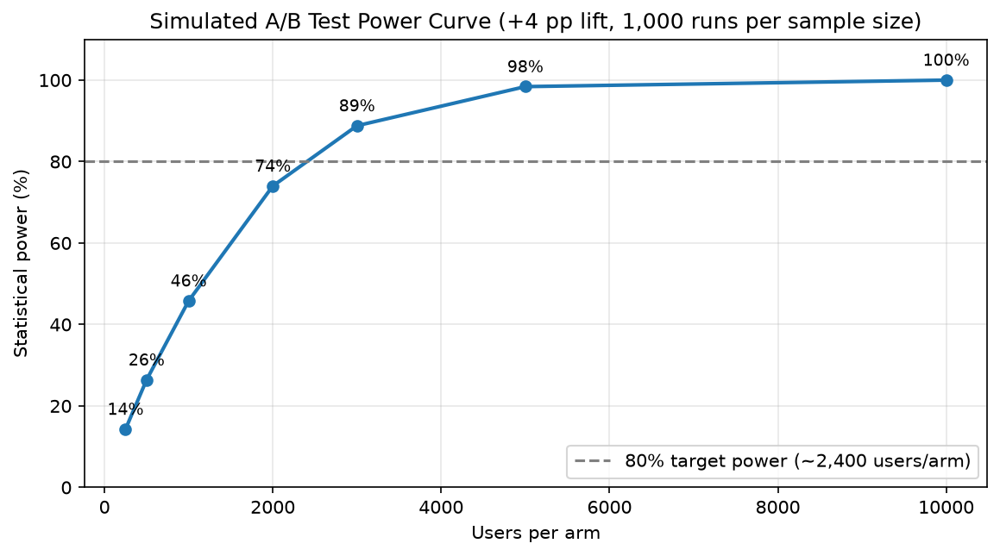

# Royal Match: A Product Analytics Case Study

Independent study by İbrahim Şamil Bacacı. Skills shown: SQL, experiment design, statistics, product thinking.

> **Disclaimer.** This is an independent learning project. I have no access to Dream Games data and no affiliation with the company. Part A uses my own gameplay log. Part B uses **synthetic data** that I generated myself. Nothing here is a claim about real Royal Match players or about the intent behind any design choice.

## Question

How do difficulty, near-miss losses and loss-framed offers shape what a player does after losing, and how would a product team test this safely, with guardrails for player experience as well as revenue?

## What is in this repo

| Part | Data | What it shows |
|---|---|---|
| **A. Real observations** | My own log: levels 1-33, 47 attempts, 15 losses, one player who never used boosters and declined every paid offer | Pilot findings and an honest account of their limits |
| **B. Simulated A/B test** | **Synthetic**, 20,000 users with a planted effect | My analysis pipeline recovers a known effect; power analysis; why guardrails need their own sample size |

## Key takeaways

1. **Losses clustered from level 24 onward** in my log: 1.10 losses per level, versus 0.17 for levels 1-23. Excluding tutorial and interlude levels the contrast is larger (1.4 vs 0.19). This is descriptive: one player, and the split point was chosen after looking at the data.
2. **Near-miss effect on retrying: inconclusive.** Retry rates after near-misses and larger misses are similar at the 25% threshold and differ at 20%. Nine losses are too few to say more.
3. **A loss-framed second offer screen coincided with sessions ending** (2 of 4 losses with it, 1 of 11 without). It appeared on every loss from level 27 on and on none before, so it is fully confounded with level and with features unlocked around then. Only a randomized test can separate the two.
4. **A test sized only for its primary metric leaves its retention guardrail blind** (Part B).

## Part B summary: simulated A/B test (synthetic data)

**Setup.** 20,000 simulated first-loss events, randomized by user into control and treatment. The treatment is a post-loss screen showing how close the player was to winning. The planted effect is +4 percentage points in the share of players who retry within two minutes. All assumptions are in [`part_b_simulation/assumptions.md`](part_b_simulation/assumptions.md).

**Result.** SQL aggregation plus a two-proportion z-test estimated a lift of **+3.4 pp, 95% CI [2.1, 4.8], p < 0.001**. The interval contains the planted 4 pp, so the pipeline works. This validates the method, not the effect, because I planted the effect.

**Power.** I repeated the experiment 1,000 times per sample size and counted how often the 4 pp lift was detected:

| Users per arm | Power |
|---|---|
| 250 | 14% |
| 500 | 26% |
| 1,000 | 46% |
| 2,000 | 74% |
| 3,000 | 89% |
| 5,000 | 98% |
| 10,000 | 100% |

About 2,400 users per arm give 80% power. This matches the closed-form estimate 16·p(1−p)/δ². Values carry roughly ±3 pp of Monte Carlo error.



**Guardrail caveat.** With about 2,400 users per arm, a D7 retention guardrail (baseline around 11%) could only detect a drop of roughly 2.5 pp. Detecting a 1 pp drop would need about 15,700 users per arm. A test should be sized for its most demanding metric, or each guardrail needs a stated minimum detectable effect up front. In this simulation D7 is causally downstream of retrying by construction, so the guardrail moves up slightly. A real guardrail could move the other way.

## Recommendations (to validate with real data)

- Randomize any loss-framed screen at the user level instead of reading its effect off observational data.
- Track session endings, D7 retention and player complaints next to revenue and purchase conversion.
- Pre-register a minimum detectable effect for every guardrail, and size the test for the hardest one.
- Measure return time after a session ends. Quitting after a loss is not the same as churning: I quit at levels 24 and 27 and came back both times.

## Status and roadmap

This is an ongoing study. The log above covers levels 1-33. I am continuing to play and log, aiming for level 100 first, then further, with extra columns (boosters, offers shown and accepted, session timing). Updates will be added here as "Level N update" notes, with the booster-free phase kept separate from any later phase.

## Limitations

- One player, no spending, no boosters, so nothing here speaks to payers.
- Rows for levels I did not log individually are recorded as first-try wins and flagged `assumed = 1`.
- Levels 7, 21, 28 and 32 are tutorial or interlude levels and are flagged separately.
- The split at level 24 was chosen after inspecting the data; no significance test is reported for it.
- Part B effects are planted by construction.

## Repository structure

```
royal-match-product-analysis/
├── README.md
├── charts/
│   ├── difficulty_ramp.png
│   └── power_table.png
├── part_a_real_observations/
│   ├── attempts.csv
│   ├── real_analysis.sql
│   └── findings.md
└── part_b_simulation/
    ├── simulate.py
    ├── power_analysis.py
    └── assumptions.md
```

## How to reproduce

**Part A.** Import `attempts.csv` into SQLite as a table named `attempts` (for example with DB Browser for SQLite), keeping the rows in their original order, then run `real_analysis.sql`.

**Part B.** Install the dependencies (`pip install numpy pandas statsmodels scipy matplotlib`), then run `python simulate.py` and `python power_analysis.py`. Seeds are fixed, so results are reproducible.
