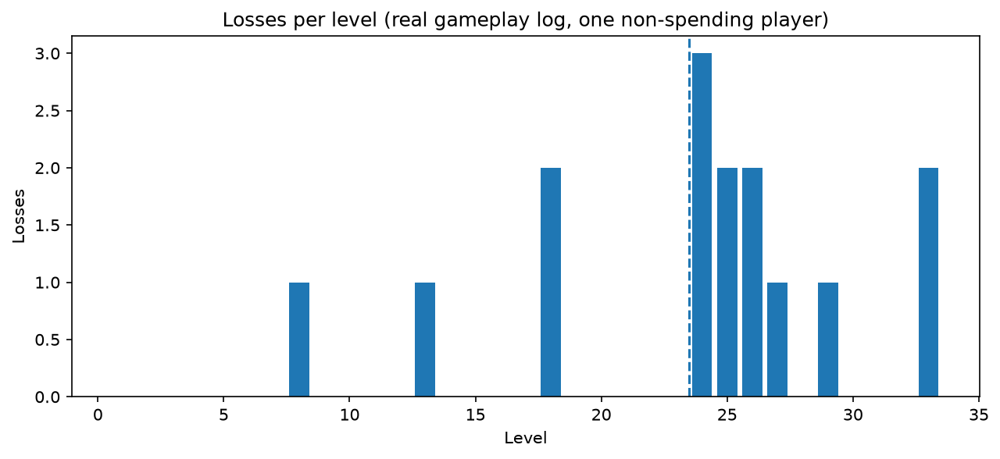

# Part A: Findings from My Own Gameplay Log

## Scope

One player, levels 1-33, 47 recorded attempts, 15 losses. I never used boosters and declined every paid offer (+5 moves, 900 gold). Levels I did not log individually were recorded as first-try wins and are flagged `assumed = 1`. These are **pilot observations, not claims about Royal Match players in general.**

Levels 7, 21, 28 and 32 are numbered levels that introduced a feature or used a non-standard format (boosters unlocked, a new feature taught, rescue-the-king and gold-collecting style levels). They are flagged `level_type = tutorial_or_interlude` and are excluded from the sensitivity analysis below. Levels 28 and 32 are also marked as assumed: I recall no losses there but did not log them one by one. Level 33 was not completed in this log.

## Data dictionary (`attempts.csv`)

| Column | Meaning |
|---|---|
| `level` | Level number |
| `result` | `win` or `lose` |
| `goal_remaining_pct` | Share of the level goal still open when I lost (my estimate), blank if not noted |
| `spectacle` | Perceived visual intensity of the level: `high` (many cascades and animations), `low` (almost none), `normal` |
| `fomo_prompt` | `1` if a loss-framed second offer screen appeared after I declined the +5 moves offer |
| `after_loss` | `R` = replayed, `Q` = ended the session |
| `assumed` | `1` = row inferred from memory or from my notes, not logged one by one |
| `level_type` | `regular` or `tutorial_or_interlude` |

## Finding 1: Losses cluster from level 24 onward

| Levels | Levels counted | First-try wins | Losses | Losses per level |
|---|---|---|---|---|
| 1-23 | 23 | 20 | 4 | 0.17 |
| 24-33 | 10 | 4 | 11 | 1.10 |

**Sensitivity.** Excluding the four tutorial and interlude levels:

| Levels | Levels counted | First-try wins | Losses | Losses per level |
|---|---|---|---|---|
| 1-23 | 21 | 18 | 4 | 0.19 |
| 24-33 | 8 | 2 | 11 | 1.4 |

The contrast gets larger, not smaller, so this pattern does not depend on how I treat those levels.

**Caveats.** The split at level 24 was chosen after looking at the data, levels are not independent trials, and many early rows are assumed wins. I report no significance test for this contrast; treat it as descriptive.

**Open question.** The pattern looks less like a smooth ramp than like hard stretches broken up by easier levels: losses at 24-27, an interlude at 28, a loss at 29, easy levels at 30-32, losses again at 33. With one player I can only flag this. A real analysis would look at win rates per level across many players and test whether interludes change what players do next.

## Finding 2: No clear near-miss effect on retrying

Of the 9 losses with a recorded remaining-goal percentage:

| Near-miss threshold | Near-miss losses retried | Larger-miss losses retried |
|---|---|---|
| 25% or less left | 4 / 6 | 2 / 3 |
| 20% or less left | 4 / 5 | 2 / 4 |

At 25% the two groups look the same; at 20% they separate. The result depends on a threshold I chose, and nine losses are too few. I treat this hypothesis as **untested**, not rejected.

## Finding 3: Sessions ended after losses that came with the book-loss offer

After I declined the +5 moves offer, a second screen appeared. It said I had collected enough books on the home-page collection event to earn a reward and would lose them unless I paid 900 gold. I describe it as a loss-framed second-chance offer.

| Losses | Count | Session ended afterwards |
|---|---|---|
| With the screen | 4 | 2 |
| Without it | 11 | 1 |

The screen appeared on **every** loss from level 27 on and on none before. It is therefore fully confounded with level, and with features unlocked around the same time (teams, the book event). I cannot tell whether it is triggered by my book count or simply unlocked at level 27, and I cannot separate its effect from rising difficulty. This is exactly why a real test needs random assignment.

Session end is also not churn: after quitting at levels 24 and 27, I came back and won.

## Additional observation (weak)

Attempts on levels I rated high-spectacle (many cascades) were won 6 of 7 times; low-spectacle attempts were won 1 of 3 times. Cascades are part of how those levels get won, so the link is partly mechanical, and the labels were assigned by me after the fact. I note it only as a prompt for a better-measured version.

## What this analysis cannot show

- Anything about paying players: I accepted no offers and used no boosters.
- Whether the offer screen is state-triggered or unlocked at a fixed level.
- Any population-level rate, since n = 1.
- Any statement about design intent.

## Hypotheses for a real test

1. Loss-framed second-chance screens increase the chance that a session ends after a loss.
2. Near-miss losses increase immediate retries.
3. Difficulty rises sharply around levels 24-27 and is eased by interlude levels.

Part B shows how I would test the first two with randomization, a primary metric, guardrails and a sample-size calculation.
